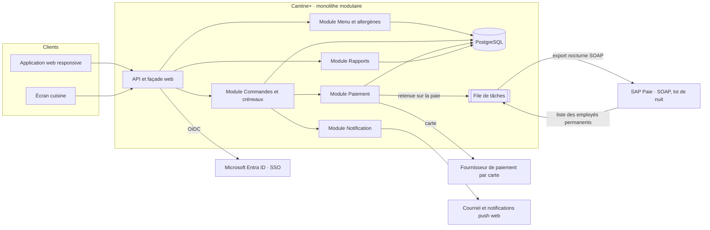

# Architecture · Cantine+

## Options comparées

| Critère | A · Monolithe modulaire | B · Microservices |
| --- | --- | --- |
| Équipe de 4 développeurs | Un seul dépôt, un seul déploiement | Plusieurs services à exploiter : charge opérationnelle disproportionnée |
| Pilote en 3 sprints | Réaliste | Le socle (orchestration, observabilité, contrats) consomme l'essentiel des 3 sprints |
| Pic de 1 500 commandes en 45 min (≈ 0,6 commande/s en moyenne) | Largement absorbé par une instance + base relationnelle ; mise à l'échelle horizontale possible | Surdimensionné pour cette charge |
| Cohérence commande / paiement / annulation | Transactions ACID locales | Transactions distribuées ou sagas à concevoir |
| Évolution future (mobile, autres sites) | Modules découpables plus tard si le besoin est démontré | Découpage déjà fait, mais coûteux dès le premier jour |

**Choix : option A, monolithe modulaire.** Voir [ADR-001](adr-001.md).

## Diagramme

## Composants

| Composant | Responsabilité | Intégration ou contrainte critique |
| --- | --- | --- |
| Application web responsive | Menu, précommande, QR de retrait | Mobile natif reporté |
| Module Menu et allergènes | Menu par site, allergènes et calories | Affichage exact exigé par la loi : un responsable nommé par site valide les changements, historique des modifications |
| Module Commandes et créneaux | Précommande jusqu'à 10 h 30, créneaux de 15 min, annulation | Verrou de clôture à 10 h 30 ; capacité par créneau ; pic de 1 500 commandes entre 9 h 45 et 10 h 30 |
| Module Paiement | Carte, retenue sur la paie, remboursement | Retenue réservée aux permanents ; remboursement automatique à l'annulation |
| Intégration SAP paie | Liste des employés (source de vérité) et export des retenues | SOAP, traitement par lot nocturne : pas de temps réel, donc cache local des employés et réconciliation quotidienne |
| Authentification | SSO via Entra ID (OIDC) | Aucun mot de passe stocké dans Cantine+ |
| Module Notification | Message « repas prêt » | Asynchrone via la file de tâches, pour ne pas ralentir la cuisine |
| Module Rapports | Rapport hebdomadaire : ventes, gaspillage, plats populaires | Lecture seule sur une réplique ou des vues, hors du pic |
| Données personnelles | Habitudes alimentaires = renseignements personnels | Loi 25 : consentement, minimisation, durée de conservation limitée |

## Réponses aux contraintes

- **Pic de 10 h 30** : cache du menu (consulté à 8 h 30), écritures de commande courtes et indexées, tests de charge à 3 fois la charge attendue avant le pilote.
- **Paie SAP** : intégration isolée derrière un port ; un échec SAP n'empêche pas la précommande par carte.
- **Allergènes** : une seule source de données, validée par un responsable ; jamais recopiée à la main dans un autre module.
- **Pilote à Laval en 3 sprints** : socle, menu, commande, carte et cuisine ; la retenue sur la paie suit au sprint 4.
